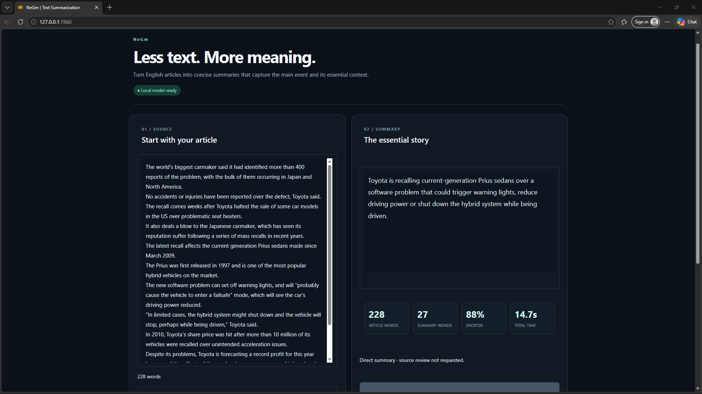
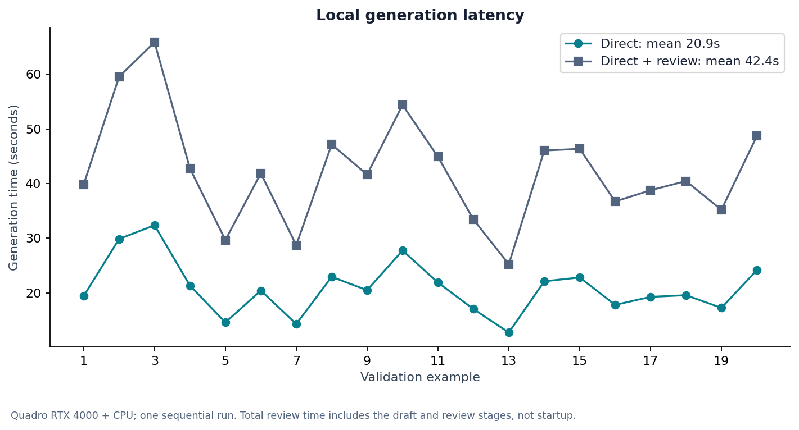
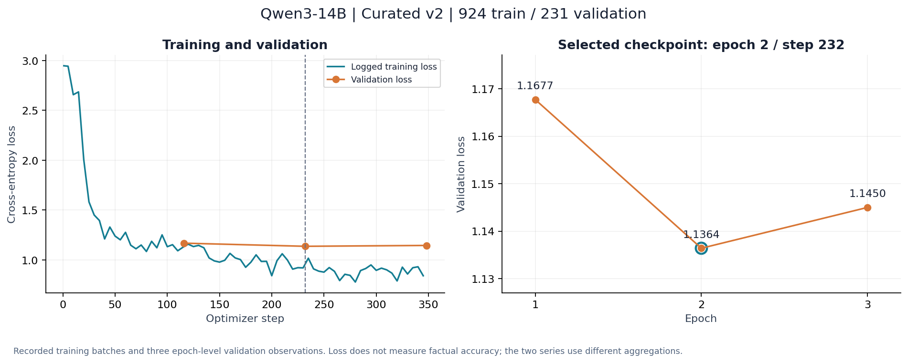
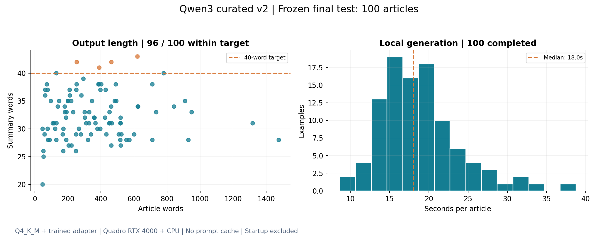

# NeGm · English News Summarization

A trained Qwen3-14B adapter for concise, source-grounded English news summaries, with a local Gradio application and reproducible evaluation reports. Training runs on a larger GPU; quantized inference runs locally using llama.cpp with CPU/GPU offloading.



## What is implemented

- Curated XSum articles paired with source-checked, AI-reviewed targets.
- A frozen 924/231 train/validation split from 1,155 eligible records; 45 withheld from 1,200 reviewed examples.
- QLoRA training and selection of the lowest-loss validation checkpoint.
- Official Q4_K_M base weights plus the trained LoRA adapter in GGUF format.
- Local inference, a two-panel Gradio UI, summary copy/download, and length/latency reporting.
- Resumable validation comparisons, a documented review decision, eleven recorded figures, and focused service tests.

## Local demo

**First-time setup:** follow [the fresh-checkout instructions](docs/setup.md#fresh-checkout-local-inference). The trained adapter is distributed separately; its public release URL is pending.

The existing project expects the following files under `artifacts/qwen3_14b_curated_v2_1200/local_model/`:

- `Qwen3-14B-Q4_K_M.gguf`
- `qwen3_curated_v2_adapter_f16.gguf`
- `qwen3_curated_v2_adapter_f16.json`

The existing isolated environment is `.local_tools/qwen_conversion/venv`. Native runtime files live in `.local_tools/llama-b11669`.

```bash
python run_local_summary.py --check
python run_local_summary.py
```

Open `http://127.0.0.1:7860`. Keep the terminal running. Press Ctrl+C to stop.
The launcher works from any directory; it finds project files relative to its own location.

The model stays local during generation. Initial setup requires downloads: approximately 9 GB for the quantized base, approximately 770 MB for the native CUDA runtime, conversion dependencies, and Gradio. Repeated launches reuse existing files. A fresh clone needs model artifacts; GitHub does not contain the weights or training data.

See [setup](docs/setup.md) for conversion, dependencies, and memory controls.

## Training record

| Item | Recorded value |
|---|---|
| Base | Qwen/Qwen3-14B |
| Base revision | `40c069824f4251a91eefaf281ebe4c544efd3e18` |
| Training method | QLoRA, NF4 base, BF16 computation |
| Adapter | Rank 8, alpha 16, dropout 0.05, linear layers |
| Train / validation | 924 / 231, seed 42 |
| Epochs / completed updates | 3 / 348 |
| Best checkpoint | Update 232, epoch 2 |
| Best validation token loss | 1.136410117149353 |
| Training host | NVIDIA A100-SXM4-40GB |

These values are transcribed from the completed run and pinned script; token loss measures target prediction, not factual accuracy. See [model card](docs/model_card.md).

## Measured local development results

Twenty validation articles were summarized directly and then reviewed by the same model against their sources. This is a development comparison, not the final test set.

| Measure | Direct | Direct + review |
|---|---:|---:|
| Mean summary words | 32.15 | 32.20 |
| At most 40 words | 19/20 | 19/20 |
| Mean generation time | 20.90 s | 42.36 s total |
| Content corrections introduced by review | — | 0 observed |

Nineteen output pairs were identical. The remaining pair only added “the”. The extra review therefore remains optional and off by default.

A separate assistant source-based assessment flagged two clear factual errors and three further wording/uncertainty concerns. It is not independent human annotation or a general accuracy estimate. See [evaluation protocol](docs/evaluation.md) and the per-example evidence in `reports/local_quality/assistant_review_20.json`.



## Inference decision

The default is direct generation with the baseline instruction. A stronger grounding prompt was also checked on the same validation articles. It fixed some cases but introduced another unsupported claim, so it was not adopted. The extra model review is experimental and off by default.

The three UI examples are selected validation articles, chosen for demonstration. They are not an unbiased test set and their compression percentages are not accuracy scores.

## Training curves

The recorded run completed 348 updates in about 48 minutes on an A100 40 GB. Validation loss was 1.1677 after epoch 1, 1.1364 after epoch 2 and 1.1450 after epoch 3. The app uses the selected epoch-2 adapter. The small final increase supports keeping that checkpoint; it does not establish a general factual-accuracy score.



The underlying logs are in `reports/training/qwen3_curated_v2/`. Report generation selects that explicit run and verifies its adapter identity instead of searching arbitrary historical logs.

## Share a running demo

```bash
python run_local_summary.py --share
```

The username defaults to `negm`. On the first launch, choose a password in the terminal; it is saved outside this repository in `~/.config/negm_summarizer/share_auth.json`. Keep that file private. Share the generated HTTPS link and access details with your tester. The local model still runs on the host workstation; it must stay awake and online.

The link is temporary and may change after restarting. This is a shared local demo, not permanent cloud hosting. Plain local mode remains available without `--share`.

## Reproduce reports and tests

```bash
PYTHONPATH=src python -m summarization.local.reporting
PYTHONPATH=src python -m summarization.local.inventory
PYTHONPATH=src python -m unittest discover -s tests -p 'test_local*.py' -v
```

Report generation requires `requirements/reports.txt`. Native inference is not required for these commands. Dataset-cleaning tests require `requirements/data.txt`. Curated word-count EDA requires `requirements/reports.txt` and reads the local frozen split without downloads.

## Curated data analysis

```bash
PYTHONPATH=src python -m summarization.eda
```

This reads the existing frozen `training_data.json`, checks split IDs and article overlap, and writes word-length distributions, source/summary relationships and compression diagnostics. It does not change the split or download model files. These are word counts, not tokenizer lengths or accuracy scores.

## Repository guide

- `src/summarization/local/`: application lifecycle, runtime setup, inference service, prompts, UI, reporting and inventory.
- `configs/qwen_local.json`: current runtime defaults and identity metadata.
- `requirements/`: separate local, reporting, data preparation and Colab training environments.
- `scripts/`: pinned training reproduction script.
- `reports/figures/`: PNG/SVG figures and provenance index.
- `docs/`: architecture, data decisions, evaluation, setup and model card.
- `artifacts/`, `data/`, `.local_tools/`: local resources excluded from Git.

Only the current Qwen runtime and its data pipeline are maintained. Old model experiments and one-off installers are removed from the working tree after backup. Setup implementations live in `scripts/`; the two root preparation commands remain available.

## Final test

On 100 frozen test articles, the deployed model completed all summaries, averaged 32.4 words and 18.83 seconds per article, and kept 96 outputs within 40 words. ROUGE-1/2/L F1 was 0.2655/0.0640/0.1877 against original XSum references.

A source-based assistant review flagged 17 material factual issues, four unsupported secondary details and 19 wording/qualification concerns; 60 outputs had no clear issue identified. These are qualitative labels, not independently human-verified accuracy. The evaluation was not used for another tuning cycle. See [full results and methods](docs/final_results.md).



## Release status

The 11 focused service, curated-data and evaluation tests pass from a clean Git checkout in the existing Python environment. The screenshot shows the working local app. Separate scripts prepare a new local environment and export the verified adapter; a clean-host GPU installation and a public adapter download URL are still pending. See [setup](docs/setup.md) and [third-party notices](docs/third_party_notices.md). Full training/evaluation articles, weights, saved login and runtime caches stay outside source Git; built-in demonstration excerpts are identified in the notices.
