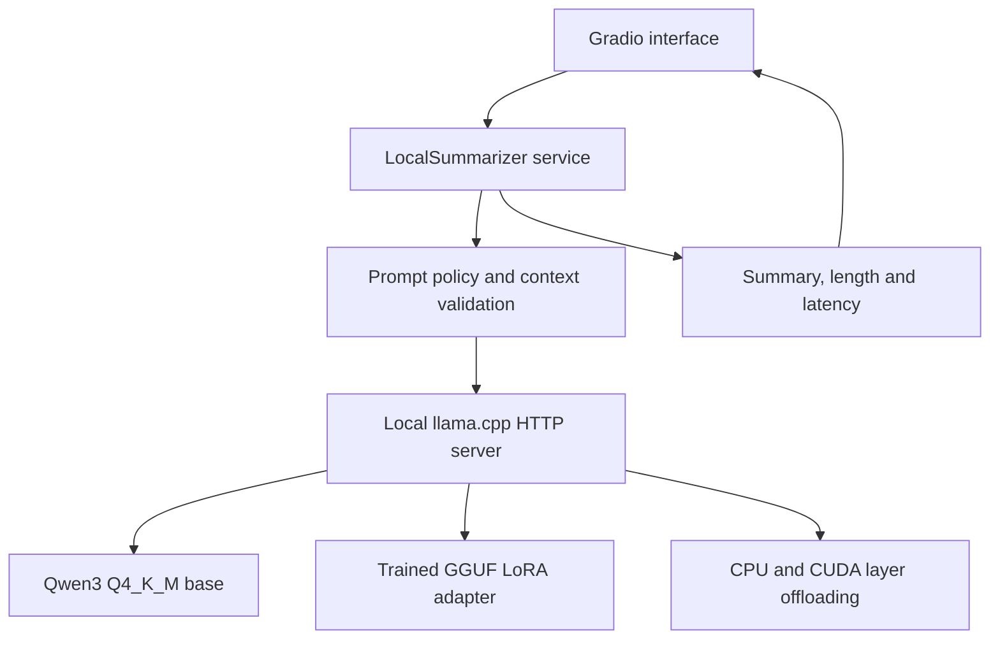

# System architecture

## Current local path

The root `run_local_summary.py` is a small entry point. It exposes compatibility functions for the existing comparison script and delegates to `summarization.local.app`.

| Module | Responsibility |
|---|---|
| `settings.py` | Stable project-relative paths, model revision, runtime tag and adapter identity |
| `runtime.py` | Official runtime setup, checksum verification, local HTTP transport and conservative offload selection |
| `service.py` | Input validation, context budget, deterministic generation, optional source review and response validation |
| `prompts.py` | Baseline, experimental candidate and source-review instructions |
| `ui.py` | Gradio presentation only; the callback is injected |
| `app.py` | CLI, isolated environment, server lifecycle, UI callback, temporary downloads and shutdown |
| `reporting.py` | Offline generation of figures from recorded reports |
| `inventory.py` | Read-only cleanup inventory |

## Lifecycle

The launcher verifies the converted adapter against its recorded SHA256 and expected trained-adapter SHA256. It never silently runs the base without the adapter. It reuses the isolated conversion environment, starts a server bound to 127.0.0.1, waits for health, then starts Gradio on 127.0.0.1:7860. Ctrl+C shuts down the child server.

The base file is checked for presence during launch; conversion previously checked GGUF magic. A complete base-weight integrity audit is separate from adapter identity verification. Public release installation should verify the official base SHA256 as well.

## Generation contract

Qwen3 ChatML with thinking disabled; greedy decoding (`temperature=0`), 160 new-token budget and one request at a time. The 4,096-token context budget includes the prompt and response allowance. Oversized input is rejected rather than silently truncated. The same check applies to a review prompt containing the article and first draft.

The 40-word limit is a target, not enforced by cutting words: an overlength output is flagged. Generation that exhausts its token budget is rejected. A model-generated review is not a factuality certificate.

## Development and historical code

The live path is `summarization.local`: settings, prompts, service, runtime, UI and lifecycle remain separate. `training_figures.py` reads the explicit curated-v2 records; `reporting.py` produces the figure index. Data loading, cleaning, curation and tests remain in the main package because they support reproducibility.

Old BART and BF16 Qwen experiments are excluded from the maintained package. The two root preparation commands delegate to implementations in `scripts/` and resolve paths from the project root. EDA reads the frozen curated split and uses word counts; it never downloads a tokenizer or model.

## Deployment boundary

The native llama.cpp API binds to 127.0.0.1. Gradio serves locally by default; `--share` creates a temporary authenticated public tunnel to the UI. Requests run on the host computer and are queued sequentially. Credentials are saved outside the project with restricted file permissions. Public sharing does not turn this into persistent hosted infrastructure.

The workstation must remain awake and connected while others use the link. Stop with Ctrl+C. Reopening the application can produce a different link. Runtime logs and sharing certificates are ignored by Git.
